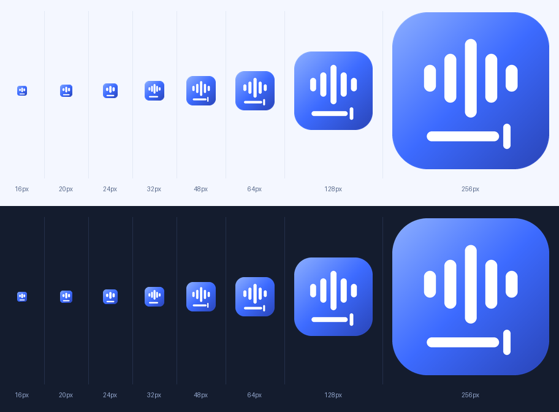

<p align="center">
  
</p>

<h1 align="center">启飞输入法 · Qifei IME</h1>

<p align="center">
  <strong>按住说，松开就有字。</strong><br>
  完全离线的中文语音输入法 · macOS 版
</p>

启飞输入法是在 [CapsWriter-Offline](https://github.com/HaujetZhao/CapsWriter-Offline)
基础上二次开发的桌面语音输入工具。语音识别与润色都在本机完成，**不联网、不上传**；
按一下 `Tab` 开始说话，再按一下结束，文字就出现在当前光标处。

本项目以 **MIT 协议完全开源**，源码、构建脚本、移植踩坑记录全部公开。

---

## ✨ 特性

- **完全离线**：SenseVoice / Fun-ASR / Paraformer / Qwen3-ASR 等本地 ASR 引擎，断网可用
- **极低延迟**：20 秒音频在 Apple Silicon 上通常 1 秒内出结果（取决于引擎）
- **三种说话方式**：`Tab` 切换录音 / 按住 `空格` 对讲 / 录音中 `空格` 暂停
- **数字 ITN**：「十五六个」自动转成「15~16 个」
- **热词替换**：按音素模糊匹配，偏门人名、术语说了就准
- **正则替换**：自定义规则，精确纠正识别结果
- **文件转录**：音视频文件拖进来，输出 `.txt` / `.srt` / 带时间戳的 `.json`
- **可选大模型润色**：本地直连 llama.cpp（不装 Ollama），也可接远程 API / Ollama
- **录音与日记**：每句话的音频和识别结果都留在本机，隐私安全
- **图形设置中心**：首次配置向导、录音悬浮条、托盘菜单

> 仓库**不包含任何模型权重**。语音模型由首次启动引导下载，润色模型按需自行导入。

## 💻 平台状态

| 平台 | 状态 |
| --- | --- |
| macOS 12+（Apple Silicon 实测 macOS 26 / Darwin 27） | ✅ 主要开发与验证平台 |
| Windows 10/11 | 继承上游实现，本仓库未做回归验证 |

macOS 上的核心链路已跑通：打包版服务端 ASR 端到端、剪贴板 → `Cmd+V` 上屏、
`Tab` / 空格快捷键、录音悬浮条。**首次启用必须在系统设置里授权麦克风、
辅助功能（macOS 26 中名为「设备控制和数据访问」）和输入监控**，否则会出现
「能录音但识别只有标点」或「按 Tab 没反应」——这些都不是程序崩溃，
详细排查见 [macOS 移植踩坑与排障记录](docs/macOS-移植踩坑与排障记录.md)。

## 🚀 从源码运行

环境要求：macOS 12+、Python 3.11+、Xcode Command Line Tools（`xcode-select --install`）。

```bash
git clone https://github.com/QK2022-2042/qifei-ime.git
cd qifei-ime

python3 -m venv .venv && source .venv/bin/activate
python3 -m pip install -r requirements-build.txt \
    -r requirements-gui.txt -r requirements-client.txt -r requirements-server.txt

python3 qifei_ime.py
```

首次启动会走一遍引导：选麦克风 → 选引擎并下载语音模型（SenseVoice 小模型约 414MB）
→ 确认快捷键 → 是否开机自启。

## 📦 打包成 .app / .dmg

必须在 macOS 主机上执行（PyInstaller 不支持交叉编译）：

```bash
bash build/build_mac.sh                    # 产出 .app + .dmg
QIFEI_SKIP_DMG=1 bash build/build_mac.sh   # 只产出 .app
```

产物在 `dist/`。安装：

```bash
ditto "dist/启飞输入法.app" "/Applications/启飞输入法.app"
open -n "/Applications/启飞输入法.app"
```

未签名、未公证的包在别人的 Mac 上会被 Gatekeeper 拦，右键 →「打开」即可。
正式分发需要 Apple Developer 账号做签名与公证，步骤见
[macOS 构建与安装说明](docs/macOS%20构建与安装说明.md)。

> ⚠️ 每次重新构建都会改变 ad-hoc 签名的 cdhash，系统里的旧授权随之失效。
> 重新安装后请在「系统设置 → 隐私与安全性」中重新勾选本程序，必要时先执行
> `tccutil reset Accessibility cn.qifei.ime`。

## ⌨️ 怎么用

| 操作 | 效果 |
| --- | --- |
| 按一下 `Tab` | 开始录音；再按一下结束并上屏 |
| 按住 `空格` | 按住说话，松开结束并上屏 |
| 录音中按 `空格` | 暂停；再按一下继续，整段合成一句 |
| `Esc` | 中断正在进行的识别 / 大模型润色 |

空格仍然是普通空格：按住超过 0.25 秒才视为录音，轻点会原样补发一个空格。
灵敏度可在 **设置 → 快捷键** 调整。

录音时屏幕底部会浮出胶囊状态条；识别结果默认以剪贴板粘贴的方式写入当前应用。
更多功能（热词、角色、文件转录、识别语言）见 [docs/](docs/)。

## 🗂️ 项目结构

```
qifei_ime.py          图形界面入口（设置中心 / 引导 / 托盘）
qifei/                界面与进程管理（PySide6）
core/                 服务端、客户端、协议与工具
  server/             音频接收与 ASR 调度
  client/             麦克风、快捷键、上屏
llmkit/               本地 llama.cpp / 远程 API 的统一封装
LLM/                  角色配置（润色、助理、翻译）
assets/               图标与截图
build/                PyInstaller 配置与 macOS 出包脚本
docs/                 使用说明、构建说明、移植排障记录
tests/                录音交互与 llmkit 回归测试
tools/                打包、模型下载、发版自检脚本
```

运行时数据（配置、日志、模型、录音）都在：

```
~/Library/Application Support/QifeiIME/
```

## 🔐 隐私

- 语音识别全部在本机完成，音频不出设备。
- 只有在你主动配置「远程 API」后端时，文本才会发送给你指定的服务商。
- 仓库内不包含任何 API Key；`LLM/*.py` 里的 `api_key` 默认留空，请填自己的。
- 本仓库不包含模型权重、构建产物、日志或任何个人录音。

## 📄 许可证与致谢

本项目以 [MIT License](LICENSE) 开源。

- 上游项目：[CapsWriter-Offline](https://github.com/HaujetZhao/CapsWriter-Offline)（MIT）
- 语音识别：[Sherpa-ONNX](https://github.com/k2-fsa/sherpa-onnx)、[FunASR](https://github.com/alibaba-damo-academy/FunASR)
- 界面：PySide6 / Qt

感谢上游作者与所有贡献者。若你基于本项目继续开发，请保留原始版权声明。
